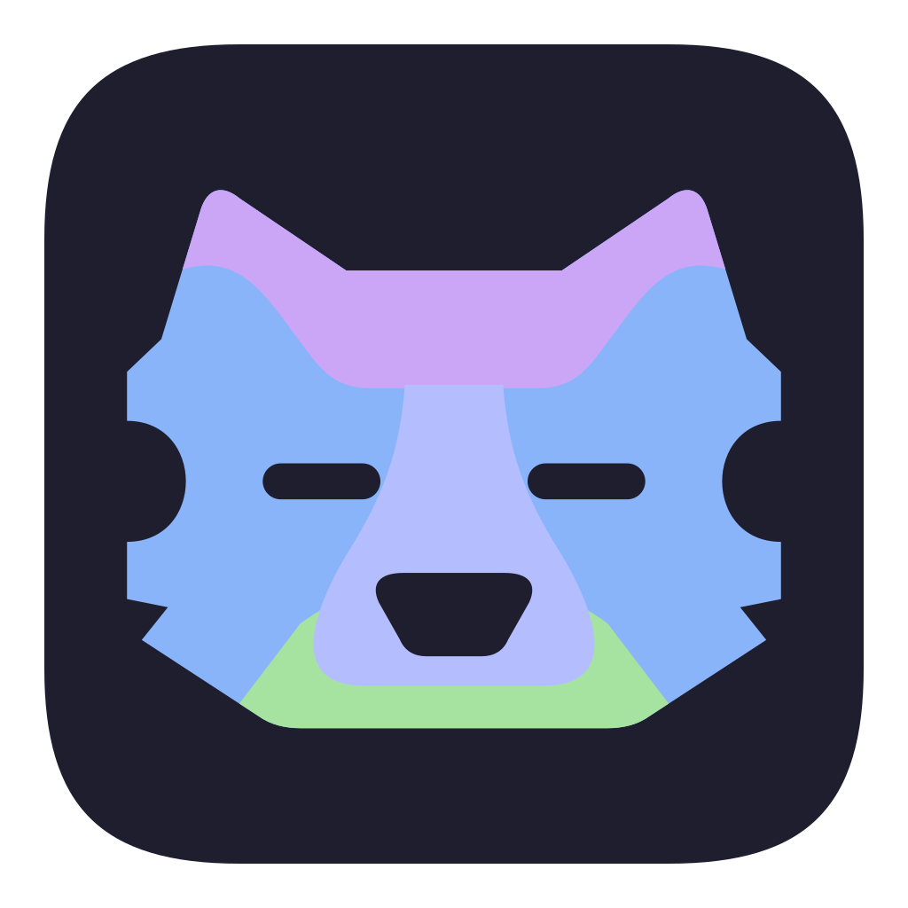

<p align="center">
  
</p>

<h1 align="center">Fen</h1>

<p align="center">Your Claude Code and Codex sessions, in the notch.</p>

<p align="center">
  <a href="https://github.com/lrpineda/fen/releases/latest/download/Fen.dmg"><b>Download for Mac</b></a>
  ·
  <a href="https://github.com/lrpineda/fen/releases">Release notes</a>
</p>

> [!NOTE]
> Fen is an early alpha that a few people are testing. Expect rough edges, and expect things to change.

## What it does

Run a few coding agents at once and you spend half your time checking which terminal wants you. Fen keeps an eye on
them for you.

- **The notch pings you.** Each running session is a ring in the notch. When one needs you (a permission, a plan, a
  question) or finishes, the notch says so, and you can answer it right there: allow, deny, pick an option or type a
  reply. Hover the notch or press ⌃⌥N to open it.
- **A task per branch.** Every task gets its own branch, git worktree and terminal, so agents don't step on each other.
  Quick add takes `Fix login bug !high #auth @api due:fri`.
- **One dashboard.** Your tasks and their terminals in one window: split panes, tasks side by side, full screen with ⌘↩,
  and ⌃Tab to jump between them.
- **Your terminal or Fen's.** Sessions run in Fen's own terminals (built on Ghostty's), in herdr if you use it, or in
  Terminal, iTerm2, Ghostty, Warp, kitty or WezTerm.

No notch on your Mac? Fen draws one at the top of your main display.

## Install

You need a Mac with Apple Silicon and macOS 14 or later, plus
[Claude Code](https://github.com/anthropics/claude-code), [Codex](https://github.com/openai/codex) or both.

1. Download [Fen.dmg](https://github.com/lrpineda/fen/releases/latest/download/Fen.dmg) and drag Fen to Applications.
2. Open it. This alpha isn't notarized by Apple yet, so macOS says it can't verify Fen. Click **Done**, open
   **System Settings → Privacy & Security**, scroll down and click **Open Anyway**. If that button isn't there, run
   this in Terminal and open Fen again:

   ```sh
   xattr -dr com.apple.quarantine /Applications/Fen.app
   ```

3. A short tour sets up the rest: your agents' hooks, your repos and a first task.

## Updates

Fen updates itself. On its second launch it asks whether to check for updates automatically, and Settings → Updates
has Check for Updates. Updates come from this repo's releases, and Fen only installs ones signed with its update key.

## What Fen changes on your Mac

- **Your agents' hooks**, only when you click Install (in the tour or Settings → Agents): Fen adds its entries to
  `~/.claude/settings.json` and `~/.codex/hooks.json`. Your own hooks stay as they are, and Remove takes out only Fen's.
- **Its own folder**, `~/Library/Application Support/Notch/` (Notch was Fen's working name): your tasks, settings and
  the hook script.
- **Your repos**: tasks get worktrees under `~/.herdr/worktrees` (Settings → Repos & Worktrees changes that). When a
  task is done, Fen keeps its uncommitted changes in a git ref and removes the worktree. The branch stays.
- **The network**: hooks reach Fen through a server on `127.0.0.1:48484` that only your Mac can connect to. Fen itself
  only goes online to check this repo for updates, and has no analytics. Your agents talk to their own services as
  usual.

## Uninstall

1. In Settings → Agents, click **Remove** next to Claude Code and Codex.
2. Quit Fen and move it to the Trash.
3. To remove its data too, delete `~/Library/Application Support/Notch`. Worktrees it made stay where they are; remove
   them with `git worktree remove` like any other.

## Feedback

Found a bug or have an idea? [Open an issue](https://github.com/lrpineda/fen/issues).

## About this repo

Fen's source isn't public yet. This repo holds its releases and the update feed that installed copies check.

Fen is built on [Ghostty](https://ghostty.org)'s terminal library and [Sparkle](https://sparkle-project.org). Their
licenses ship inside the app, in `Fen.app/Contents/Resources/ThirdPartyNotices.txt`.

Fen isn't affiliated with Anthropic or OpenAI.
